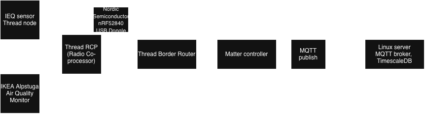

# Architecture

## Matter device
https://matterdevices.io/thread/ikea-alpstuga-air-quality-monitor/

## Matter-MQTT bridge
https://cz.mouser.com/en/ProductDetail/Nordic-Semiconductor/nRF52840-Dongle?qs=gTYE2QTfZfTbdrOaMHWEZg%3D%3D
https://github.com/matter-js/matterjs-server
https://github.com/make2explore/Open-Thread-Border-Router-on-RaspberryPi

Example of whole home assistant https://www.home-assistant.io/yellow/

## Time series DB
https://www.tigerdata.com/docs/get-started/choose-your-path/install-timescaledb
https://saiparvathaneni.medium.com/short-reads-guide-to-timescaledb-cassandra-and-mongodb-26a0a3efa185#:~:text=However%2C%20it%20lacks%20native%20support%20for%20complex,horizontal%20scalability%2C%20MongoDB%20is%20a%20strong%20contender.
